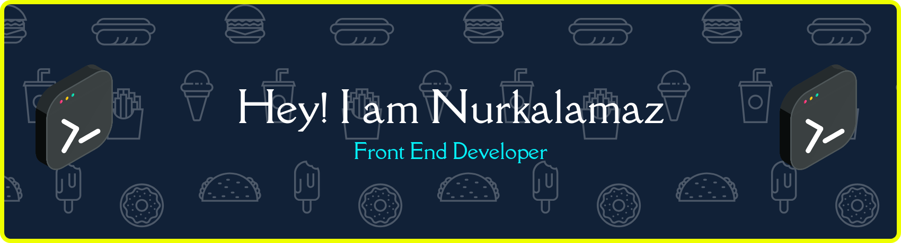

<h3 align="left">Hello, I'm Nurkalam Abdurrahman</h3>

  A <strong>Front-End Developer</strong> from Indonesia with an interest in building responsive, user-friendly, and functional web applications.

---

### About Me

- Exploring web development since 2022.
- Focused on modern front-end development and user interface implementation.
- Currently working with React, Tailwind CSS, and REST API integration.
- Interested in building clean, maintainable, and accessible web applications.
- Continuously learning and improving through hands-on projects.

### Currently Learning

- Developing modern web applications with React.
- Building responsive interfaces using Tailwind CSS.
- Integrating REST APIs and managing application state.
- Improving front-end architecture and development practices.

### Development Philosophy

> "Clean and simple code creates powerful applications."

I believe good software is not only about functionality, but also about maintainability, usability, and thoughtful design. My goal is to create applications that are intuitive for users and easy for developers to understand and maintain.

### Tech Stack

  
  
  
  
  
  

---

### Featured Projects

**1. Echoes of the Lost Dungeon**

A top-down pixel art adventure game developed for the Gimersia competition using Godot Engine. The game features dungeon exploration, combat, and interactive gameplay mechanics.

- [Repository](https://github.com/NurkalamAbdurahman/rt-rw-gimersia)
- [Play Demo](https://rafli1127.itch.io/echoes-of-the-lost-dungeon)

**2. GoTask — Task Management Application**

A task and workspace management application inspired by Trello, featuring drag-and-drop boards, workspace management, team members, and API integration.

- [Repository](https://github.com/NurkalamAbdurahman/gotask)
- [Live Demo](https://go-task-fe-9hiv-3u7ott389-nurkalamabdurahmans-projects.vercel.app/)

**3. Responsive Website Slicing**

A responsive website implementation developed as an IT Club final project, focusing on translating a web design into a functional layout using HTML, CSS, and Tailwind CSS.

- [Repository](https://github.com/NurkalamAbdurahman/responsive-website-slicing)
- [Live Demo](https://website-monyet-nurkalamabdurahmans-projects.vercel.app/)

---

### GitHub Statistics

  
  

---

### Contribution Activity

  

---

### Connect With Me

  
  
  

---

  <i>Always learning, building, and improving.</i>

